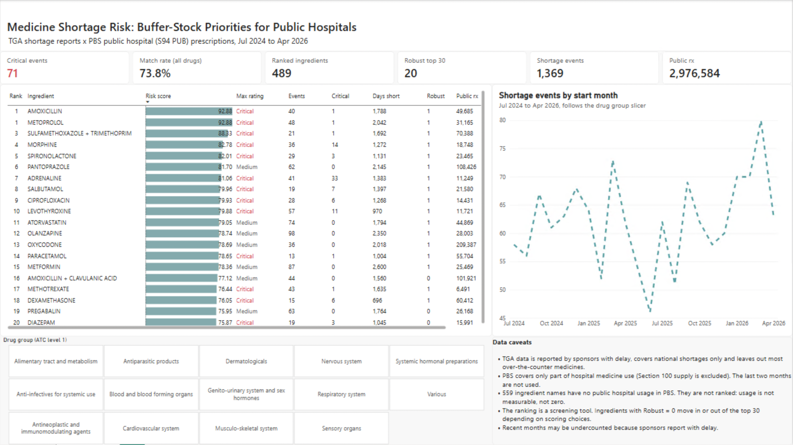
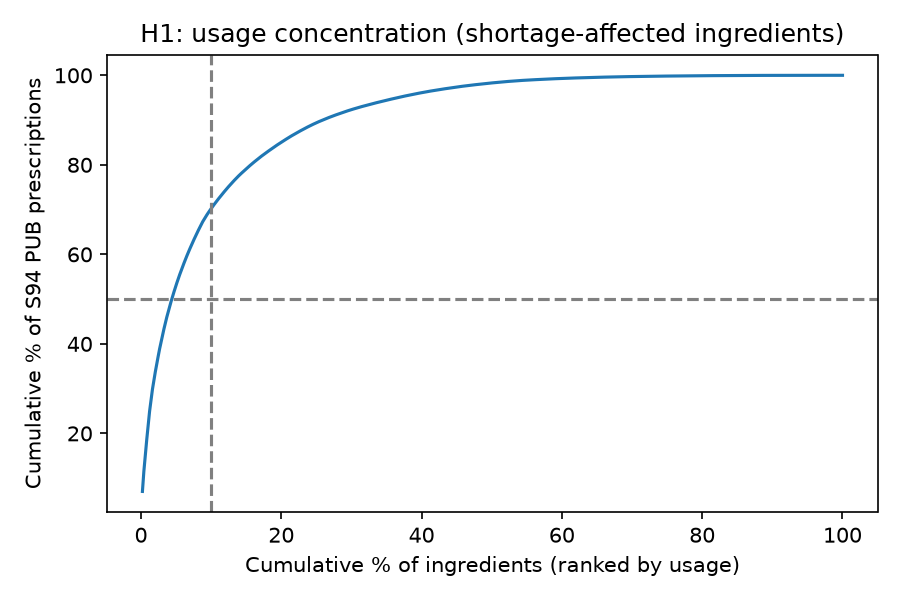
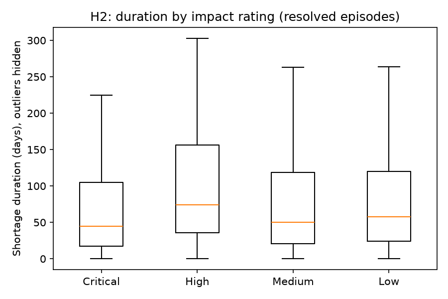
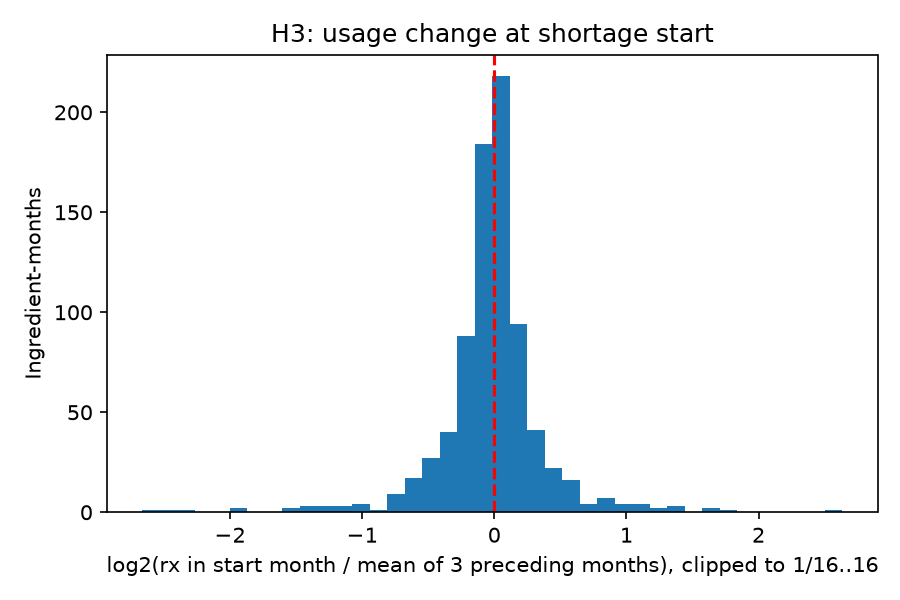

# Which Medicines Should a Victorian Public Health Service Buffer Before the Next National Shortage?

> One-page summary for decision makers: [reports/executive_summary.md](reports/executive_summary.md)

## Key findings

- **Priority list.** 489 ingredients with both shortage records and public hospital prescriptions are ranked; METOPROLOL and AMOXICILLIN rank first. 20 of the top 30 stay in the top 30 under all three scoring variants (`robust_top30`).
- **H1 supported.** The top 10% of ingredients (49) account for 70.3% of public hospital prescriptions; the top 49 by risk score cover only 46.8%.
- **H2 supported.** Critical shortages resolve faster: median 45 days against 56 (difference -11 days, 95% CI -18 to -6).
- **H3: no measurable effect.** Prescriptions do not fall in the month a shortage starts (median ratio 0.997, 95% CI 0.985 to 1.004).



## 1. Business Problem
**Context.** Shortages of medicines in Australia are reported to the Therapeutic Goods Administration (TGA) by the companies that supply them (sponsors). A public health service cannot hold buffer stock of every medicine, because budget and storage are limited. Procurement has to choose which medicines to buffer before a shortage occurs.

**Stakeholder.** The pharmacy procurement team of a Victorian public health service. This is a hypothetical scenario built for this portfolio project, not a request from a real organisation.

**Objective.** Rank active ingredients by risk, defined as shortage exposure (number of shortage episodes and days short) multiplied by public hospital usage (prescriptions), and turn the ranking into a buffer-stock priority list.

**Scope.** Shortages reported to the TGA; public hospital use measured by Pharmaceutical Benefits Scheme (PBS) prescriptions from public hospital pharmacies (`S94 PUB`), July 2024 to April 2026. Both sources are national: the TGA reports national shortages, and the PBS table in this project has no state field, so usage is not specific to Victoria (not verified). "Victorian" describes the stakeholder setting, not a restriction of the data.

**Key questions.**

1. Which active ingredients combine the highest shortage exposure with the highest public hospital usage?
2. Is public hospital usage concentrated in a small share of ingredients (H1)?
3. Are Critical shortages resolved faster than other shortages (H2)?
4. Do public hospital prescriptions fall in the month a shortage starts (H3)?

**Success metric.** A priority list that procurement can act on and that holds up under alternative scoring: each ingredient in the top 30 is flagged as robust (`robust_top30`) if it stays in the top 30 under all three scoring variants.
## 2. Dataset
Two public sources are combined: shortage reports from the Therapeutic Goods Administration (TGA) and monthly prescription counts from the Pharmaceutical Benefits Scheme (PBS) Date of Supply data. Both were downloaded on 6 November 2026. Source links and terms of use are in `data/README.md`.

### Raw files

| File | Source | Content | Size |
|---|---|---|---|
| `tga_shortages_active_20261106.csv` | TGA | One row per ARTG product (ARTG = Australian Register of Therapeutic Goods), with its current shortage status | 1,044 rows |
| `tga_shortages_archived_20261106.csv` | TGA | Past shortage episodes; one product can have several | 9,697 rows, 4,945 distinct ARTG IDs |
| `pbs_dos_2024-07_2025-06.csv`, `pbs_dos_2025-07_2026-06.csv` | PBS | Prescription counts by month x item code x drug type x patient category x pharmacy type x script type | 5,198 distinct item codes |
| `pbs_item_drug_map.csv` | PBS | Maps each PBS item code to a drug name | 99.96% of the 5,198 item codes found |

Public hospital use is the PBS pharmacy type `S94 PUB`.

### Analysis tables (SQLite, `data/project.db`)

| Table | One row is | Rows | Coverage |
|---|---|---|---|
| `tga_episodes` | One shortage episode of one ARTG product | 10,722 | 5,334 ARTG products, 1,048 ingredient keys |
| `pbs_public_monthly` | One ingredient in one month, public hospital pharmacies | 14,142 | 742 ingredient keys, 22 months (July 2024 to April 2026), 3,363,566 prescriptions |
| `pbs_ingredient_lookup` | One ingredient key | 742 | Links PBS drug names to the ingredient key |

`tga_episodes` has 10,722 rows: the two TGA exports total 10,741 rows, and 19 superseded duplicate rows were removed (see section 3).

### How the tables relate

TGA records products (ARTG) and PBS records item codes, so the two sources share no key. The link is the active ingredient: PBS item code, then drug name through the item map, then a normalised ingredient key, matched to the normalised active ingredient in the TGA data. One ingredient can have many shortage episodes and many months of prescriptions, so the join is many-to-one on both sides.

After the join:

- 489 ingredient keys have both shortage records and public hospital prescriptions (2,976,584 prescriptions). Only these are ranked.
- 559 TGA ingredient keys have no public hospital prescriptions in the window. Their usage is unknown, not zero, so they are not ranked.
- 253 PBS ingredient keys (386,982 prescriptions, 11.5% of the total) have no TGA match.

### Time coverage

Prescriptions cover July 2024 to April 2026. May and June 2026 are excluded because the PBS notes say the most recent months are less complete. Shortage episodes use the full TGA history in the export, so the shortage side covers a longer period than the usage side.

### Data caveats

- TGA data is reported by the companies that supply the medicines, so reports can be late. It covers national shortages only and excludes most non-reportable (over-the-counter) medicines.
- On 6 November 2026 the TGA stated that its archived export had a technical issue and some historical records may be missing.
- 292 rows of the active export are discontinuation records (`deletion_from_market`) with no start or end date. They are kept in the table but do not enter the risk score.
- The archived export has a `High` impact rating (103 rows) that the active export does not show.
- The PBS report excludes Section 100 supply, so it covers only part of hospital medicine use.
- TGA records are per product and PBS records are per ingredient. A hospital can switch to another brand of the same ingredient, which can hide a drop in prescriptions.
- Drug groups (ATC level 1) in the dashboard slicer are assigned by the most frequent ATC letter among the PBS items of an ingredient. The count is by item, not by prescriptions, and it includes non-hospital forms such as eye and skin preparations. 35 of the 489 ranked ingredients belong to more than one group, so a bridge table lists them under each group. 24 ingredient keys could not be matched to an ATC code (group "Unclassified"); they are outside the 489 and were not examined in detail.

## 3. Data Cleaning
All cleaning decisions are logged with their reasons in `reports/cleaning_log.md` (15 decisions); counts come from `notebooks/02_clean.ipynb`. Raw files are never edited. The decisions that change the results are below.

### Key decisions

Four decisions change the results most:

1. **Shared ingredient key.** TGA and PBS names are normalised into one `ingredient_key`; 85.0% of TGA episodes with an ingredient then match the PBS item map.
2. **Public hospitals only.** Keeping `S94 PUB` leaves 164,292 rows and 3,656,321 prescriptions.
3. **May and June 2026 excluded.** PBS says recent months are less complete (14,080 rows and 290,710 prescriptions removed).
4. **Durations only for valid resolved episodes.** 8,295 of 8,298 resolved episodes have a valid duration; H2 depends on it.

<details>
<summary>All cleaning decisions (TGA and PBS tables)</summary>

**TGA shortage data**

| Decision | Reason | Effect |
|---|---|---|
| Merge the active and archived exports: skip the free-text preamble, take the header at `ARTG ID`, convert column names to snake_case, read the archived file with `index_col=False` | The exports have different columns and a preamble; archived rows end with an extra comma that would shift the columns | 1,044 + 9,697 = 10,741 rows |
| Parse dates explicitly as d/mm/yyyy | Avoids day/month confusion | 0 unparsed values in the four date columns |
| Derive `episode_type` (current, anticipated, resolved, discontinuation, unknown). A row with a deletion-from-market date is a discontinuation even if it also has an end date | In 100 of the 138 rows with both dates, deletion comes before the end date, so the end date looks like a planned date (official meaning not verified) | 8,298 resolved episodes (8,086 archived, 212 active) |
| Remove superseded duplicates: rows sharing `artg_id`, start date and `episode_type` are collapsed to the one with the latest end date | The archived export has no version column | 19 archived rows removed; 10,741 to 10,722 rows |
| Flag date anomalies instead of deleting rows; compute `duration_days` only for resolved episodes with end date on or after start date and on or before 2026-11-06 | Protects the resolution-speed test (H2) from impossible durations | 8,295 of 8,298 resolved episodes have a duration (Critical 747, High 103, Medium 2,403, Low 5,042) |
| Keep 11 active Current rows whose end date has already passed, flagged `end_passed` | The TGA status is the primary field | 11 rows flagged |
| Keep the one row without an artg name; exclude the one row without an active ingredient from ingredient analysis | The ingredient is needed for the join; the name is not | 1 row excluded from ingredient analysis |

### PBS prescription data

| Decision | Reason | Effect |
|---|---|---|
| Concatenate the two DOS files; read the item map as `latin-1`; upper-case and trim drug names | UTF-8 decoding of the item map failed; names must match across files | 788,898 rows, 24 months, 0 duplicate keys; 12,245 unique item codes; 445 names changed |
| Keep public hospitals only (`PHRMCY_TYPE` = `S94 PUB`, confirmed in the PBS explanatory notes) | The scope is public hospital usage | 164,292 rows, 3,656,321 prescriptions |
| Drop rows without a drug name (items `00000B` and `99999Z`) | `99999Z` is the generic code for unlisted RPBS-only items per the PBS notes; `00000B` is not explained there | 80 rows, 149 prescriptions |
| Exclude months 202605 and 202606 | PBS states recent months are less complete and the report is not for recent trends | 14,080 rows, 290,710 prescriptions |
| Drop non-drug preparations (items whose ATC level 5 code starts with Z) | They are not medicines | Only `EXTEMPORANEOUSLY PREPARED` appears: 22 rows, 1,908 prescriptions |

</details>

Result: 3,363,566 public hospital prescriptions over 22 months (202407 to 202604).

### Joining the two sources

TGA uses salt forms and `~` between ingredients; PBS uses generic names and `+`. Both sides are normalised into a shared `ingredient_key`:

- Remove salts and hydrates, including words such as medoxomil, cilexetil and besilate.
- Remove bracketed text and `ACID TARTRATE`.
- Treat `~`, `(&)` and `+` as the same separator, then sort the components.
- Map `CLAVULANATE` to `CLAVULANIC ACID`.

| Measure | Before normalisation | After normalisation |
|---|---|---|
| Distinct TGA ingredient strings matching the PBS item map | 405 of 1,351 (30.0%) | 916 (67.8%) |
| Distinct TGA strings with public hospital usage in the window | not measured | 684 (50.6%) |
| Episodes (10,721 with an ingredient) matching the item map | not measured | 9,116 (85.0%) |
| Episodes with public hospital usage in the window | not measured | 7,915 (73.8%) |
| Ingredient keys: in the item map / with usage (of 1,048) | not measured | 698 / 489 |

**Accepted merges.** 8 PBS keys combine more than one drug name (betamethasone, erythromycin, estradiol + norethisterone, ferrous, fluticasone, hydrocortisone, metoprolol, prednisolone) because the analysis is at active-ingredient level. For example, metoprolol merges succinate and tartrate, so the specific form must be checked before buffering.

**Unmatched remainder is not forced.** 350 keys (1,605 episodes) do not match the item map: 248 keys (1,241 episodes) have no PBS name sharing the first component (reason not verified), and 102 keys (364 episodes) are mostly combinations where PBS lists only one component. A further 1,201 episodes match the map but have no public hospital usage in the window. All of these are treated as "usage not measurable", not zero usage, and are not ranked.

**Known gaps in the matching.** A few salt words are not removed (etexilate, pamoate), so dabigatran and olanzapine do not match. Whether normalisation wrongly merged distinct TGA ingredients has not been checked.

## 4. Analysis

All figures below are computed from the SQLite tables built in `sql/` and read in `notebooks/03_analysis.ipynb`. Each hypothesis has a rule fixed before the test (`reports/framing.md`).

### Q1. Which ingredients combine the highest shortage exposure with the highest public hospital usage?

**Method.** Each of the 489 ingredients with public hospital prescriptions gets a risk score:

`risk_score = 100 x ((pct_rank(events) + pct_rank(union shortage days) + max_rating / 4) / 3) x pct_rank(prescriptions)`

- `events`: resolved and current shortage episodes, counted per ARTG product.
- `union shortage days`: overlapping resolved episodes of the same ingredient are merged, so days when several products are short at once count once. Summing days instead over-counted by 1.4x to 3.3x for the top 5 ingredients. Events and days are counted over the full TGA history in the export, not only the 22 usage months (for example METOPROLOL: 2,042 days).
- `max_rating`: Critical = 4, High = 3, Medium = 2, Low = 1.
- `prescriptions`: public hospital (`S94 PUB`) prescriptions, July 2024 to April 2026.

The score is the average of the three shortage components multiplied by the usage rank, so an ingredient needs both exposure and usage to rank high.


*Reading the dashboard:* the Events, Critical and Days short columns in the table count each ingredient's full TGA history (6,583 events and 430 Critical events across the 489 ranked ingredients). The cards at the top count only episodes that started between July 2024 and April 2026 (1,369 events, 71 Critical), so the two do not add up.

**Result.**

- METOPROLOL (92.8827) and AMOXICILLIN (92.8771) are first. They share rank 1 only because the rank is computed on the score rounded to 2 decimals. Third is SULFAMETHOXAZOLE + TRIMETHOPRIM (88.33).
- The top 30 is saved in `reports/priority_list.csv`.
- Sensitivity: two alternative scoring variants, each compared with the main score across all 489 ingredients. `alt` (events counted only if they start in the usage window) gives a Spearman rank correlation of 0.984 and a top-30 overlap of 23/30. `alt2` (`max_rating` replaced by the percentile rank of Critical events) gives 0.981 and 23/30. The two variants correlate at 0.963 with each other.
- 20 of the top 30 stay in the top 30 under all three scoring variants (`robust_top30`).

### Q2. Is public hospital usage concentrated in a small share of ingredients? (H1)

**Method.** Among the 489 matched ingredients, rank by public hospital prescriptions and take the top 10% (49 ingredients). Rule: H1 is false if these account for 50% or less of prescriptions.



**Result.** H1 is supported. The top 49 ingredients account for 70.3% of public hospital prescriptions.

- Sensitivity: adding ingredients that are in the PBS item map but have no public hospital prescriptions (counted as 0 usage; n = 698, top 10% = 70) gives 78.1%.
- The three highest-usage ingredients are OXYCODONE (209,387 prescriptions), FERRIC CARBOXYMALTOSE (133,435) and PANTOPRAZOLE (108,426).
- The top 49 by risk score cover only 46.8% of prescriptions. H1 is about usage, not risk.
- There is no comparison with all PBS ingredients, so this result does not show that shortage-affected ingredients are more concentrated than medicines in general.

### Q3. Are Critical shortages resolved faster than other shortages? (H2)

**Method.** 8,295 resolved episodes with a valid duration (end date on or after start date and on or before 2026-11-06). Duration = end date minus start date. Rule: H2 is false if the Critical median is greater than or equal to the median of the other ratings. Uncertainty of the difference is estimated by bootstrap (5,000 resamples, seed 42).



**Result.** H2 is supported.

| Group | Episodes | Median duration (days) |
|---|---|---|
| Critical | 747 | 45 |
| All other ratings | 7,548 | 56 |
| Difference | | -11 (95% CI -18 to -6) |

- Median by rating: Critical 45, High 74, Medium 50, Low 58. High is the longest.
- The mean goes the other way (Critical 101.7 days, others 94.8) because durations are skewed to the right. The median is used for that reason.
- Share of episodes longer than 180 days: Critical 12.7%, others 14.4%.
- Sensitivity: comparing Critical with Low + Medium only gives 45 vs 56 days.
- 702 episodes with a duration of 0 days are kept.

### Q4. Do public hospital prescriptions fall in the month a shortage starts? (H3)

**Method.** For each ingredient and month in which a shortage episode starts, `ratio` = prescriptions in the start month divided by the mean of the 3 preceding months. Rule: H3 is true if the median ratio is below 1. Tests: bootstrap confidence interval and sign test. As a control, the same ratio is computed for every ingredient-month in the same window.



**Result.** H3 is true by the rule but there is no measurable effect.

- Per ingredient-month row (n = 805): median ratio 0.997; 409 rows below 1, 380 above, 16 equal (50.8% below 1). Bootstrap 95% CI 0.985 to 1.004; sign test p = 0.319.
- Per shortage episode (each row repeated by its number of episodes; n = 1,070): median 0.998, 50.5% below 1.
- Control (all ingredient-months, n = 11,225): median 0.995, the same as in shortage months.
- Sensitivity: counting a missing start-month value as 0 prescriptions gives 0.996 (0.997 per episode). The 46 rows with a Critical episode give 0.999.
- The interval includes 1 and the shortage months look like the control, so the data do not show a drop in public hospital prescriptions when a shortage starts.

### Limits of these tests

- The bootstrap and the sign test treat observations as independent, but many episodes belong to the same ingredient. The effect of this has not been checked.
- H2 uses resolved episodes only. Ongoing shortages have no end date, so long shortages are under-represented.
- H3 covers 290 ingredients and measures one month (the start month). A longer or delayed effect is not captured.
- The notebook reports H3 in two units (rows and episodes), which is why two medians (0.997 and 0.998) appear above.

## 5. Insights

### Insight 1. Usage is concentrated, but the highest-usage ingredients are not the highest-risk ones

- **What.** The top 10% of the 489 ingredients (49) account for 70.3% of public hospital prescriptions. The top 49 by risk score account for only 46.8%. The highest-usage ingredient, OXYCODONE (209,387 prescriptions), ranks 13th by risk score.
- **Why.** The risk score multiplies shortage exposure by usage, so an ingredient with heavy use but few or less severe shortages ranks lower than one with both. The score also uses usage as a percentile rank, which compresses large differences in volume.
- **So what.** A buffer list built on volume alone and a list built on risk are not the same list. Procurement can cover most prescription volume with a small number of ingredients, but a volume-only list would miss ingredients with heavy shortage exposure. There is no comparison with all PBS ingredients, so this does not show that shortage-affected medicines are more concentrated than medicines in general.

### Insight 2. Critical shortages are not the longest-lasting

- **What.** The median Critical shortage lasted 45 days, against 56 days for all other ratings (difference -11 days, 95% CI -18 to -6). High-rated shortages last longest (median 74 days). The share lasting more than 180 days is similar: 12.7% for Critical and 14.4% for the others.
- **Why.** Not verified. The data holds no information on how shortages are managed. One possible explanation is that Critical shortages receive more attention from sponsors and regulators, but this was not tested.
- **So what.** A typical resolved shortage lasts about 1.5 to 2.5 months (medians 45 to 74 days by rating), which is a planning reference for how many weeks of cover a buffer should provide. A severity rating does not predict duration, so buffer size should not be scaled up only because an ingredient is rated Critical. 12.7% of Critical episodes last more than 180 days, and ongoing shortages are excluded, so these durations understate the real range.

### Insight 3. Prescriptions do not fall when a shortage starts

- **What.** The median ratio of prescriptions in the start month to the previous three months is 0.997 (95% CI 0.985 to 1.004). Months without a shortage start give 0.995. The data show no drop in public hospital prescriptions.
- **Why.** Not verified. Possible explanations: hospitals dispense another brand of the same ingredient (PBS counts per ingredient), hospitals use existing stock, sponsors report a shortage after it has begun, or the effect is spread over a longer period than one month. The data cannot separate these.
- **So what.** Monthly prescription counts cannot be used as an early warning that a shortage has started. At ingredient level there is no sign that demand falls to match supply, so a buffer should be sized to cover normal demand, not reduced demand.

### Insight 4. The ranking is a screening tool: 20 of the top 30 are stable, and the rating component cannot separate severity

- **What.** 20 of the top 30 ingredients stay in the top 30 under all three scoring variants; the other 10 move in or out. AMOXICILLIN has 1 Critical event and ADRENALINE has 33, and both receive the same maximum rating of Critical.
- **Why.** The maximum rating saturates: one Critical event scores the same as many. Events are also counted per ARTG product, which favours ingredients sold under many brands. The three score components have equal weights, which is an arbitrary choice.
- **So what.** The 20 robust ingredients are the first candidates for a buffer review. For the other 10, and for any ingredient with a high Critical event count, procurement should check the underlying columns (events, Critical events, days short) before deciding. Ingredients that merge several drug forms need a check of the specific form: METOPROLOL combines succinate and tartrate.

## 6. Recommendations

The recommendations are ordered by priority (impact on shortage risk against effort to carry out). Impact and effort are judgements, not measured values. The ranking is a screening tool, so each action starts from the list and ends with a human check.

### Priority 1. Review the 20 robust ingredients first

- **Action.** For each ingredient with `robust_top30 = 1` in `out_dash_ranking`, record a decision: buffer, do not buffer, or monitor. Record the specific drug form before deciding.
- **Why.** These 20 are stable under all three scoring variants, and some keys merge several drug forms (Insight 4).
- **Impact / effort.** High / low. The list already exists in `reports/priority_list.csv` and the dashboard.
- **Metric.** Share of the 20 ingredients with a documented decision.

### Priority 2. Check the other 10 and the high-Critical ingredients before deciding

- **Action.** For the 10 top-30 ingredients that are not robust, and for any ranked ingredient with many Critical events (for example ADRENALINE with 33, MORPHINE with 14), read the Events, Critical and Days short columns before deciding.
- **Why.** The maximum rating gives one Critical event the same score as 33 (Insight 4).
- **Impact / effort.** Medium / low.
- **Metric.** Number of these ingredients reviewed, and how many changed decision after the check.

### Priority 3. Size the buffer from ingredient-level duration and normal demand

- **Action.** For each ingredient chosen for a buffer, take the distribution of its own resolved shortage durations from `out_shortage_duration`, choose the cover (in days) from a high percentile of that distribution, and base the quantity on normal monthly demand.
- **Why.** Durations vary widely (Insight 2) and demand does not fall when a shortage starts (Insight 3). The percentile and the quantity rule are for procurement to set; this project does not compute them.
- **Impact / effort.** High / medium.
- **Metric.** Cover in days against the ingredient's longest recent shortage; days with stock-out during a TGA-listed shortage.

### Priority 4. Watch the TGA shortage list for ranked ingredients, not prescription counts

- **Action.** Check the TGA shortage list for the ranked ingredients on a fixed schedule and trigger a procurement review when one is listed as current or anticipated.
- **Why.** Monthly prescription counts showed no change at shortage start (Insight 3), so they cannot serve as an early warning.
- **Impact / effort.** Medium / low.
- **Metric.** Time from a TGA listing to a documented procurement action. Sponsors report with delay, so this measures the response, not the shortage itself.

### Priority 5. Replace the PBS proxy with the service's own dispensing data and refresh the ranking

- **Action.** Re-run the ranking with the health service's own dispensing volumes in place of PBS public hospital prescriptions, and refresh it whenever new PBS and TGA exports are loaded.
- **Why.** PBS data excludes Section 100 supply, and 559 TGA ingredient keys have no measurable public hospital usage. Own data would cover both gaps, and would show whether usage is specific to Victoria (see Scope).
- **Impact / effort.** High / high. It needs access to internal data.
- **Metric.** Share of the service's own dispensing volume covered by ranked ingredients; overlap of the top 30 between refreshes.

## Appendix

### Repository structure

```text
medicine-shortage-risk-au/
├─ README.md
├─ requirements.txt
├─ LICENSE                      MIT (code only)
├─ data/
│  ├─ README.md                 sources, links, download date, terms
│  ├─ raw/                      original files (not committed)
│  ├─ processed/                aggregated and lookup tables (CSV); row-level TGA tables are not committed
│  └─ project.db                SQLite database (not committed)
├─ notebooks/
│  ├─ 01_profile.ipynb          profiling of the raw files
│  ├─ 02_clean.ipynb            cleaning and ingredient normalisation
│  └─ 03_analysis.ipynb         tests of H1 to H3 and figures
├─ sql/
│  ├─ 01_schema.sql             table definitions
│  ├─ 02_join_shortage_usage.sql
│  ├─ 03_windows.sql
│  ├─ 04_risk_score.sql
│  └─ 05_dashboard.sql          tables read by the dashboard
├─ src/
│  ├─ run_sql.py                runs SQL files, loads CSVs, exports out_* tables
│  └─ build_atc.py              builds the ATC level-1 lookup tables for the dashboard slicer
├─ reports/
│  ├─ framing.md                problem, hypotheses and rules fixed before testing
│  ├─ cleaning_log.md           15 cleaning decisions with reasons
│  ├─ executive_summary.md      one-page summary for decision makers
│  ├─ priority_list.csv         top 30 ingredients by risk score
│  └─ figures/
└─ dashboard/
   ├─ medicine-shortage-risk-au.pbix
   └─ dashboard_overview.png
```

### How to re-run

The numbers in this README come from files downloaded on 6 November 2026. A later download gives different numbers.

1. Clone the repository and create the environment (macOS or Linux):

   ```bash
   git clone https://github.com/giaphu20056/medicine-shortage-risk-au.git
   cd medicine-shortage-risk-au
   python3 -m venv .venv
   source .venv/bin/activate
   pip install -r requirements.txt
   ```

2. Download the five raw files listed in `data/README.md` into `data/raw/`, using the file names given there.
3. Open `notebooks/02_clean.ipynb` with the `.venv` kernel and run it from the first cell to the last. It writes `tga_episodes.csv`, `pbs_public_monthly.csv` and `pbs_ingredient_lookup.csv` to `data/processed/`.
4. Create the database and load the three CSVs. Each output line should end with `OK`:

   ```bash
   python3 src/run_sql.py sql/01_schema.sql --load
   ```

5. Build the analysis tables and export them to `data/processed/`:

   ```bash
   python3 src/run_sql.py sql/02_join_shortage_usage.sql sql/03_windows.sql sql/04_risk_score.sql sql/05_dashboard.sql --export
   ```

6. Build the ATC drug-group tables used by the dashboard slicer. The script reads `data/raw/pbs_item_drug_map.csv`, `data/processed/pbs_ingredient_lookup.csv` and `data/processed/out_risk_ranking.csv`, so it runs after step 5:

   ```bash
   python3 src/build_atc.py
   ```

   It writes `ingredient_atc.csv` and `ingredient_atc_bridge.csv` to `data/processed/`.

7. Open `notebooks/03_analysis.ipynb` with the `.venv` kernel. It reads the tables from `data/project.db`.
8. The dashboard (`dashboard/medicine-shortage-risk-au.pbix`) needs Power BI Desktop on Windows.

### AI tools used

Claude was used as an AI-assisted development tool for drafting and refining 
SQL queries, Python notebook code, and initial README wording.

All SQL queries and Python cells 
were executed and checked in VS Code, DB Browser for SQLite, and Power BI. 
Outputs were validated against the source data before inclusion in this repository.

How outputs were checked:

- **Row counts at load.** `run_sql.py` compares the number of rows in each CSV with the database table and prints `OK` or `MISMATCH`.
- **Second calculation of key results.** The H1 share (top 49 ingredients, 70.3%), the H2 episode counts by rating and the H3 row counts (809 rows, 805 after removing 4 missing values) were recomputed in SQL and matched the notebook.
- **Hand calculation.** The METOPROLOL risk score was recomputed by hand from the percentile columns and matched 92.88 (approximately).
- **Dashboard.** The six card values were recomputed with SQL on the `out_dash_*` tables and matched.
- **Sensitivity tests.** Two alternative scoring variants for the risk score; sensitivity variants for H1 to H3 (section 4).
- **Spearman recomputation.** The correlations and top-30 overlaps in section 4 are recomputed in the "Ranking sensitivity check" cells at the end of `notebooks/03_analysis.ipynb` from `out_risk_ranking`, and matched.
- **Source pages.** Public hospital pharmacy type (`S94 PUB`) was confirmed in the PBS explanatory notes.

Statements marked "not verified" in this README were not checked.

### Data citations

- Therapeutic Goods Administration, Medicine Shortage Reports Database (active and archived exports), downloaded 6 November 2026: https://www.tga.gov.au/safety/shortages/medicine-shortage-reports-database. © Commonwealth of Australia. Terms of use (https://www.tga.gov.au/copyright) read on 8 November 2026; see `data/README.md`.
- Analysis based on Pharmaceutical Benefits Scheme and Repatriation Pharmaceutical Benefits Scheme Date of Supply Data, Australian Government Department of Health, Disability and Ageing, www.pbs.gov.au. Files downloaded 6 November 2026 from https://pbs.gov.au/statistics/dos-and-dop/dos-and-dop.

The code is MIT-licensed. Raw TGA and PBS files are not included, and neither are the two row-level TGA tables (`tga_episodes.csv` and `out_shortage_duration.csv`); the steps in "How to re-run" rebuild them. The repository contains aggregated and lookup tables derived from TGA and PBS data. `data/README.md` records the TGA terms of use as read on 8 November 2026 and what is still not verified.
